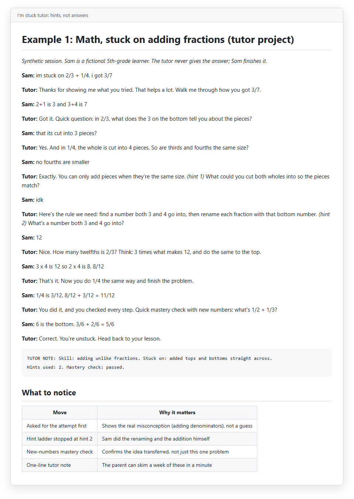
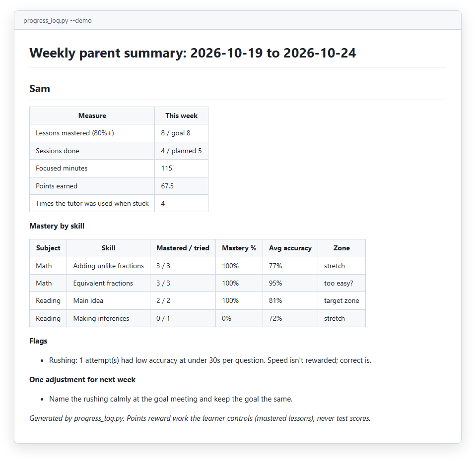
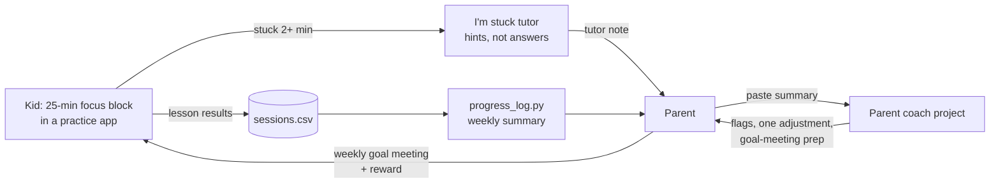
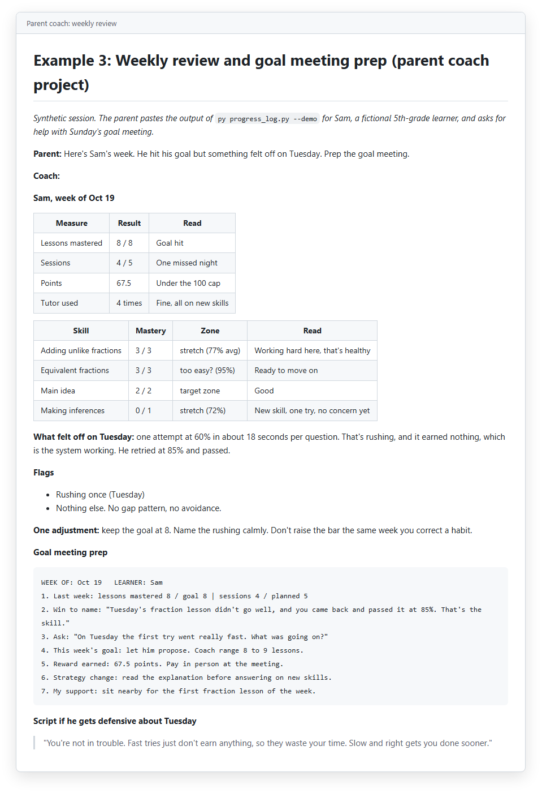

# alpha-school-coach

**An AI coach I built to help my kids work through their school curriculum at home: hints, not answers.**


*A synthetic "I'm stuck" session. The tutor never gives the answer; the kid finishes it, then passes a new-numbers check.*

## The problem

I wanted my kids to get the parts of the Alpha School approach that the research actually backs: short focused blocks, a real mastery bar, rewards for effort they control, and an adult who sets goals with them every week. The apps alone don't do that. Parents who try them at home without the structure around them tend to end up in a nightly fight.

And a plain chatbot is the wrong tutor for a kid. Ask it a homework question and it hands over the answer. That's the opposite of learning.

So I split the job in two. One Claude Project coaches **me**, the parent, to run the routine like a good guide. A second, locked-down project is the kids' "I'm stuck" button: it asks to see their attempt, gives the smallest hint that works, and makes them finish.

## What it does

- **Parent coach** ([claude/PROJECT_INSTRUCTIONS.md](claude/PROJECT_INSTRUCTIONS.md)): reads a week of results, flags rushing, avoidance, gaps or too-easy work, preps the weekly goal meeting, and gives me a short script when a session goes sideways. One adjustment per kid per week, never a list.
- **Kid tutor** ([claude/TUTOR_INSTRUCTIONS.md](claude/TUTOR_INSTRUCTIONS.md)): attempt first, find the broken step, hint ladder (question, then concept, then a worked example with *different* numbers), kid finishes, one new mastery-check problem, a one-line note for me.
- **Playbook template** ([claude/knowledge/coach-playbook-template.md](claude/knowledge/coach-playbook-template.md)): goals, rewards, nightly and weekend routines, goal-meeting template, stall signals. Fill it in and upload it.
- **Claude skill** ([skills/home-learning-coach/SKILL.md](skills/home-learning-coach/SKILL.md)): the parent coach as a portable skill for Claude Code or claude.ai.
- **`progress_log.py`**: a tiny, standard-library script that turns a CSV of lesson results into a weekly parent summary with mastery % per skill.


*`py progress_log.py --demo`: one week for Sam, a fictional 5th grader. Mastery per skill, the zone each skill is in, and one flag.*

## Controls

I'm a CPA, so I think in controls. These are the ground rules that matter here:

| Rule | Why |
|---|---|
| A lesson counts only at **80%+** | A real bar is what makes the reward mean something |
| 100% earns 1.25x; retries earn 0.5x, 0.25x, then nothing | Stops point farming by guessing and retrying |
| Rushing (under 80% at under 30s a question) earns nothing and gets flagged | Speed isn't rewarded; correct is |
| Reward inputs the kid controls, never test scores | Kids know how to finish a lesson; they don't know how to "produce" a score |
| The tutor never gives final answers or writes their work | Hints, not answers. The kid does the last step |
| No punishments tied to learning, no clawing back rewards | Reset smaller and rebuild momentum instead |
| Kid privacy: nicknames only, no schools, IDs or diagnoses in either project | The coach doesn't need them |
| The tutor sends anything about safety or feelings to a trusted adult | It's a homework helper, not a counselor |
| The parent decides | Claude drafts; a human decides |

## Architecture




*The parent coach reading the same week: what happened Tuesday, one adjustment, and a filled-in goal-meeting template.*

## Quickstart

**Use the Claude Projects** (no code): follow [docs/parent-guide.md](docs/parent-guide.md). It takes about 30 minutes.

**Try the summary script.** Requires Python 3.10+. The script itself has no dependencies.

**Windows (PowerShell):**

```powershell
git clone https://github.com/markvalderrama001-svg/alpha-school-coach.git
cd alpha-school-coach
py progress_log.py --demo
py progress_log.py my-week.csv --goal-lessons 8 --planned-sessions 5 --points-cap 100 --out summary.md
```

**Run the tests:**

```powershell
py -m venv .venv
.venv\Scripts\python -m pip install pytest
.venv\Scripts\python -m pytest -q
```

<details>
<summary>macOS / Linux (bash)</summary>

```bash
git clone https://github.com/markvalderrama001-svg/alpha-school-coach.git && cd alpha-school-coach
python3 progress_log.py --demo
python3 -m venv .venv
.venv/bin/python -m pip install pytest
.venv/bin/python -m pytest -q
```

</details>

CSV format (one row per lesson attempt):

```
date,learner,subject,skill,lesson,attempt,accuracy_pct,questions,minutes,tutor_used
2026-10-19,Sam,Math,Equivalent fractions,M-101,1,90,10,9,N
```

## Examples

All synthetic, all with a fictional learner:

- [examples/01-math-stuck-hints.md](examples/01-math-stuck-hints.md): adding unlike fractions, two hints, kid finishes
- [examples/02-reading-main-idea.md](examples/02-reading-main-idea.md): topic vs main idea, strategy hint, new-text check
- [examples/03-weekly-parent-summary.md](examples/03-weekly-parent-summary.md): weekly review and goal-meeting prep

## What I learned

- The structure does the work, not the app. Short blocks, a hard bar and a weekly meeting changed more than any tool.
- Small goals on school nights. Sleep and regular homework come first, and if it ever feels like a second job, we pause for a week.
- Praise the strategy, not the kid's smarts. "You kept going when it got hard" lands better than "you're so smart."
- Be honest about evidence. Mastery checks, quick feedback, rewarding effort and a caring coach each have research behind them. I expect steady gains from 30 minutes a night, not miracles.

## Project structure

```
claude/PROJECT_INSTRUCTIONS.md              Parent coach (paste into a Claude Project)
claude/TUTOR_INSTRUCTIONS.md                Kid "I'm stuck" tutor (separate project)
claude/knowledge/coach-playbook-template.md Playbook to fill in and upload
skills/home-learning-coach/SKILL.md         Parent coach as a Claude skill
progress_log.py                             CSV -> weekly parent summary (stdlib only)
fixtures/sessions_demo.csv                  Synthetic week for --demo
tests/test_progress_log.py                  pytest suite
examples/                                   Three synthetic sessions
docs/parent-guide.md                        Setup and weekly review guide
docs/*.png                                  Screenshots
pyproject.toml                              Package metadata and pytest config
.gitattributes                              LF line endings, PNGs as binary
```

Independent parent project. Not affiliated with or endorsed by Alpha School; the name is used only to describe the approach this routine follows.

---

**About.** Mark Valderrama, CPA · Finance Engineer. I use this with my own kids; this repo is a sanitized version with a fictional learner and synthetic data. [LinkedIn](https://www.linkedin.com/in/markvalderrama/)

MIT License, see [LICENSE](LICENSE).
